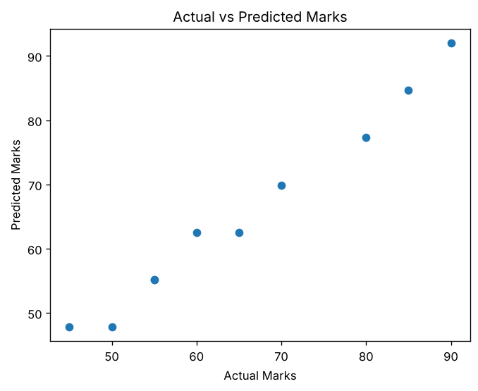
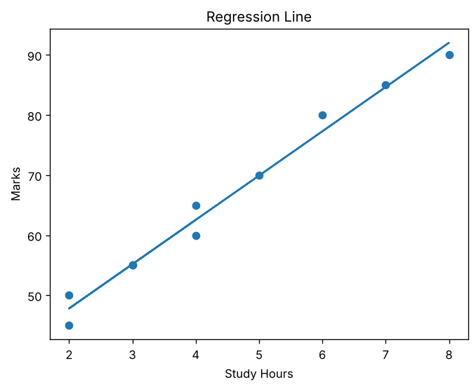

# Study Hours Regression Evaluation

Beginner-friendly Python project that trains a scikit-learn linear regression model to predict marks from study hours, evaluates it with MAE and R2 score, and visualizes actual vs predicted values and the regression line using matplotlib.

## Setup

```bash
git clone https://github.com/<your-username>/study-hours-regression-evaluation.git
cd study-hours-regression-evaluation
pip install -r requirements.txt
```

## Usage

```bash
python main.py
```

The script builds a small dataset of `Study_Hours` and `Marks`, fits a `LinearRegression` model, prints the evaluation metrics, and opens two plots one after another (close the first window to see the second). Edit the `data` dictionary at the top of `main.py` to try your own values.

## Sample output

```
MAE: 1.5520833333333315
R2 Score: 0.982638888888889
```

| Actual vs Predicted | Regression Line |
| --- | --- |
|  |  |

## Notes

- MAE is the average size of the prediction error in marks (lower is better). R2 close to 1 means the model explains most of the variation.
- The model is evaluated on the same data it was trained on, so the scores look optimistic. For a fairer check, split the data with `train_test_split`.
- `plt.show()` needs a display. On a headless server, set `MPLBACKEND=Agg` and use `plt.savefig(...)` instead.
